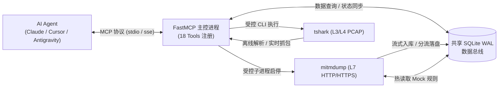

# atengk-mcp-server-traffic-inspector

<p align="center">
  <strong>专为 AI Agent / LLM 打造的网络流量抓包、会话检索、底层链路诊断、请求重放与规则 Mock 全功能 MCP Server</strong>
</p>

<p align="center">
  <a href="https://pypi.org/project/atengk-mcp-server-traffic-inspector/">
    
  </a>
  <a href="https://pypi.org/project/atengk-mcp-server-traffic-inspector/">
    
  </a>
  <a href="https://github.com/atengk/mcp-server-traffic-inspector/actions/workflows/ci.yml">
    
  </a>
  <a href="https://github.com/atengk/mcp-server-traffic-inspector/releases">
    
  </a>
  <a href="./LICENSE">
    
  </a>
  <a href="./CONTRIBUTING.md">
    
  </a>
</p>

---

## 📖 项目简介

`atengk-mcp-server-traffic-inspector` 是一款工业级全栈网络流量巡检与抓包 Model Context Protocol (MCP) Server。采用 **主控与受控子进程解耦架构**，基于共享 SQLite WAL 数据总线连接应用层（L7 `mitmproxy`）与传输层（L3/L4 `tshark`），为 AI Agent 赋予完整的网络流量观测与排障闭环：



---

## ✨ 核心特性

- 🌐 **应用层 (L7) 流量拦截与操控**：基于受控 `mitmdump` 子进程捕获 HTTP/HTTPS 流量；支持多条件分页检索、基于 `httpx` 的参数变异重放（Replay & Diff）及 SQLite 规则热同步非阻塞 Mock/改写。
- 📡 **网络层 (L3/L4) 原始网卡抓包与深度分析**：集成 Wireshark `tshark` 引擎，支持网卡枚举、双重安全熔断（默认 2000 包 / 60 秒）的实时抓包及离线 PCAP 深度解析（TCP 重传率、RTT 时延、DNS 耗时）。
- 🩺 **全栈 SessionDiagnosis 智能根因诊断**：自动聚合慢请求 Top 5、互斥状态码分布及精确占比、高频端点与底层链路指标，输出结构化健康度（0~100）与可操作排障建议。
- 🛡️ **LLM 上下文防爆保护**：列表检索严禁携带 Body；详情接口默认截断至 2048 字符预览；超大载荷（>256KB）自动分流至临时文件，支持一键落盘原始无损文件。
- 📦 **标准 HAR 1.2 归档导出**：一键将捕获会话及完整载荷导出为标准 `.har` 归档文件，完全兼容浏览器开发者工具导入。
- 🔌 **跨平台系统代理托管与安全退出还原**：Windows 下通过注册表一键托管全局代理并在主控退出时自动还原初始状态（防断网）；非 Windows 平台优雅降级为环境变量配置指引。

---

## 💡 AI Agent 常用交互提示词 (Prompt Examples)

配置完成后，您可以直接在 AI Agent 对话框（如 Cursor、Claude Desktop、Antigravity 等）中发送以下提示词，Agent 将自主调用本 MCP Server 的工具链：

### 场景一：HTTP 会话抓包与慢接口排查
> **用户提示词**：  
> “请帮我启动 HTTP 代理抓包，监听端口 8080，过滤域名 `api.mycompany.com`。随后我会发起业务调用，请帮我列出返回 4xx/5xx 或响应时间超过 1 秒的请求，并诊断其异常原因。”

### 场景二：接口故障注入与非阻塞 Mock 模拟
> **用户提示词**：  
> “请添加一条 Mock 拦截规则，将所有匹配 `*/v1/order/checkout*` 的请求拦截并直接返回 HTTP 500 状态码，响应正文为 `{"error": "ORDER_TIMEOUT", "message": "支付网关超时"}`，方便我测试客户端的降级容灾逻辑。”

### 场景三：历史请求参数变异重放与差异对比 (Replay & Diff)
> **用户提示词**：  
> “请查询最近一次会话中请求 `/v1/users/profile` 失败的流量 ID，将请求头中的 `Authorization` 替换为测试 Token `Bearer mock-token-123` 并重放该请求，对比新响应与旧响应在状态码和返回数据上的差异。”

### 场景四：原始网卡抓包与底层协议链路诊断
> **用户提示词**：  
> “请查看当前主机的抓包网卡列表，并在第一张网卡上启动 30 秒的 PCAP 抓包（过滤条件为 `tcp port 443`）。抓包完成后调用诊断工具，分析当前网络是否存在高 TCP 重传率或 RTT 延迟突增的情况。”

### 场景五：网络会话完整导出为标准 HAR 文件
> **用户提示词**：  
> “请将当前抓包会话的所有 HTTP 流量以及完整请求/响应 Body 导出为本地文件 `session_backup.har`，我要导入到 Charles 和 Chrome DevTools 中进行留存归档。”

---

## 🛠️ 快速开始

### 方式 1：使用 `uvx` 免安装开箱即用（推荐）

无需手动克隆代码库，支持在各主流 MCP 客户端中一键接入：

#### 桌面 MCP 客户端配置

在客户端配置文件（如 `claude_desktop_config.json` 或各编辑器的 MCP 设置）中添加：

```json
{
  "mcpServers": {
    "traffic-inspector": {
      "command": "uvx",
      "args": [
        "atengk-mcp-server-traffic-inspector"
      ]
    }
  }
}
```

#### 配置文件路径参考
- **Claude Desktop (Windows)**: `%APPDATA%\Claude\claude_desktop_config.json`
- **Claude Desktop (macOS)**: `~/Library/Application Support/Claude/claude_desktop_config.json`
- **Cursor**: `Settings -> Cursor Settings -> Features -> MCP`
- **Windsurf**: `~/.codeium/windsurf/mcp_config.json`

---

### 方式 2：使用 Docker 容器化运行（内置 `tshark`）

Docker 镜像已内置 `tshark`、`uv` 及完整 Python 运行环境，开箱即具备全栈三/四层与七层抓包能力：

```bash
# 启动 SSE 模式容器 (8000 为 MCP 端口，8080 为 HTTP 代理端口)
docker run -d --name traffic-inspector \
  -p 8000:8000 \
  -p 8080:8080 \
  ghcr.io/atengk/mcp-server-traffic-inspector:latest

# 执行容器内运行环境自检
docker exec -it traffic-inspector mcp-server-traffic-inspector --check
```

---

### 方式 3：本地源码调试与开发

```bash
# 1. 克隆代码库并配置 Git 规范提交钩子
git clone https://github.com/atengk/mcp-server-traffic-inspector.git
cd mcp-server-traffic-inspector
git config core.hooksPath .githooks

# 2. 同步安装依赖
uv sync --all-extras --dev

# 3. 执行环境自检探针 (检查 Python、mitmdump、tshark 与 CA 状态)
uv run mcp-server-traffic-inspector --check

# 4. 启动本地 stdio 模式服务
uv run mcp-server-traffic-inspector
```

---

### 依赖要求 (Prerequisites)

| 功能模块 | Windows 依赖 | Linux 依赖 | macOS 依赖 | 说明 |
| :--- | :--- | :--- | :--- | :--- |
| **HTTP 代理抓包 (L7)** | Python 3.11+ (内置 mitmproxy) | Python 3.11+ | Python 3.11+ | 纯 Python 用户态实现，开箱即用 |
| **底层 PCAP 抓包 (L3/L4)** | Wireshark + Npcap | tshark + libpcap | Wireshark + libpcap | 需底层网络驱动支持 |
| **进程感知与拓扑审计** | Windows 原生 (含动态切片) | 优雅降级为网卡抓包 | 优雅降级为网卡抓包 | 自动发现进程树与多服务器画像 |

#### 抓包引擎快速安装命令
- **Windows**: `winget install WiresharkFoundation.Wireshark`（自动包含 tshark 与 Npcap）
- **Ubuntu/Debian**: `sudo apt-get install -y tshark`
- **macOS**: `brew install wireshark`

---

## 🧰 MCP Tools 能力矩阵 (18 Tools)

本服务完整实现了 **18 个 MCP Tools**，覆盖网络流量观测与排障的全生命周期：

| 领域模块 | 工具名称 | 核心参数 | 功能描述 |
| :--- | :--- | :--- | :--- |
| **HTTP 抓包生命周期** | `start_http_capture` | `listen_port=8080`, `filter_host=None` | 启动受控代理子进程，按需仅落盘目标域名流量并透传其他网络 |
| | `stop_http_capture` | 无 | 停止当前抓包代理，持久化保留历史会话供离线分析 |
| | `get_capture_status` | 无 | 查询代理运行状态、监听端口、已捕获流数与运行时长 |
| **流量检索与详情** | `list_http_flows` | `session_id`, `host`, `status_code`, `status_family`, `method`, `min_duration_ms`, `sort_by`, `limit`, `offset` | 多维条件分页检索请求流摘要；**绝不携带任何 Body，保证 LLM 上下文轻量** |
| | `get_http_flow_detail` | `flow_id`, `max_body_chars=2048`, `dump_body_to_file=False` | 查看完整 Headers 与截断文本预览；支持强制落盘无损原始文件 |
| **全栈分析与诊断** | `analyze_http_traffic` | `session_id=None`（默认最近会话） | 聚合慢请求 Top 5、互斥状态码分布及精确占比、高频端点 Top 10 与最大 Payload Top 3 |
| | `analyze_pcap_file` | `file_path`, `display_filter=None`, `limit=50` | 深度分析 PCAP 协议占比、TCP 重传率、RTT 与 DNS 统计；自动挂载元数据展示多服务器拓扑与进程矩阵 |
| | `diagnose_network_session` | `session_type="http"\|"pcap"`, `target=None` | 自动计算链路健康度评分（0~100），输出明确异常清单与排障建议 |
| **PCAP 原始抓包** | `list_network_interfaces` | 无 | 解析网卡索引与描述信息（无可用接口时优雅返回 `[]`） |
| | `start_pcap_capture` | `interface=1`, `process_path=None`, `process_name=None`, `target_pids=None`, `bpf_filter=None`, `keep_raw_pcap=False` | 启动网卡或目标进程树实时抓包，支持动态端口时空切片、多服务器拓扑审计与双重安全熔断 |
| | `stop_pcap_capture` | 无 | 停止抓包并返回生成的 `.pcap` 文件、数据包统计、进程家族与多服务器拓扑画像 |
| **重放与规则 Mock** | `replay_http_request` | `flow_id`, `modify_headers=None`, `modify_body=None`, `modify_url=None` | 基于历史 Flow 参数变异重放，无损读取原始大请求体并计算新旧响应 Diff |
| | `add_intercept_rule` | `url_pattern`, `action="mock"\|"modify"`, `mock_status=200`, `mock_headers`, `mock_body`, `modify_request_headers`, `modify_response_headers` | 下发非阻塞动态规则，支持 Mock 短路返回与请求/响应头动态改写 |
| | `list_intercept_rules` | 无 | 查看当前生效的所有动态拦截与改写规则清单 |
| | `clear_intercept_rules` | `rule_id=None`（未传时清空全部） | 移除指定单条规则或清空全部动态拦截规则 |
| **系统代理与运维** | `get_ca_certificate` | 无 | 定位 `mitmproxy` 本地 CA 根证书路径，提供跨平台系统证书库导入命令 |
| | `toggle_system_proxy` | `enable: bool`, `port=8080`, `host="127.0.0.1"` | Windows 注册表代理托管；**主控退出时自动安全还原防断网**；非 Windows 降级指引 |
| | `export_http_session` | `output_path`, `session_id=None`, `format="har"` | 将会话全部流及保真载荷（含 >256KB 分流大文件）导出为标准 HAR 1.2 归档 |

---

## ⚙️ CLI 命令行参数与环境变量

命令执行参数优先级严格遵循：**CLI 命令行参数 > `MCP_TRAFFIC_INSPECTOR_*` 环境变量 > 内置默认值**。

| CLI 选项 | 对应环境变量 | 默认值 | 详细说明 |
| :--- | :--- | :--- | :--- |
| `-h, --help` | - | - | 输出命令行参数说明与帮助文档并退出 |
| `-v, --version` | - | - | 输出当前版本号并退出 |
| `--check` / `--doctor` | - | `False` | 运行环境自检探针，检查依赖与权限后按健康状态退出（退出码 0 或 1） |
| `-t, --transport` | `MCP_TRAFFIC_INSPECTOR_TRANSPORT` | `stdio` | MCP 传输协议：`stdio`、`sse`、`streamable-http` |
| `--host` | `MCP_TRAFFIC_INSPECTOR_HOST` | `127.0.0.1` | 在 `sse` 或 `streamable-http` 模式下绑定的监听地址 |
| `-p, --port` | `MCP_TRAFFIC_INSPECTOR_PORT` | `8000` | 在 `sse` 或 `streamable-http` 模式下绑定的监听端口 |
| `--tshark-path` | `MCP_TRAFFIC_INSPECTOR_TSHARK_PATH` | 自动探测 | 显式指定 `tshark` 可执行文件绝对路径 |
| `--db-path` | `MCP_TRAFFIC_INSPECTOR_DB_PATH` | 系统临时目录 | 显式指定 SQLite 数据库路径（**指定路径时退出后保留该数据库文件**） |
| `--log-level` | `MCP_TRAFFIC_INSPECTOR_LOG_LEVEL` | `INFO` | 日志级别（`DEBUG`、`INFO`、`WARNING`、`ERROR`）；`stdio` 模式强制输出至 `stderr` |

---

## 🩺 常见问题与排障 (FAQ)

### 1. 抓取 HTTPS 请求提示证书不信任或 TLS 握手失败？
* 调用 MCP 工具 `get_ca_certificate` 获取本地 CA 证书路径。
* **Windows**：以管理员身份运行 `certutil -addstore -user Root "<ca_cert_path>"`，或双击 `.cer` 文件导入至“受信任的根证书颁发机构”。
* **Linux**：`sudo cp "<ca_cert_path>" /usr/local/share/ca-certificates/mitmproxy.crt && sudo update-ca-certificates`。

### 2. Windows 下开启系统代理后，服务退出会导致断网吗？
* **绝不会**。`mcp-server-traffic-inspector` 内置完善的 `LifecycleManager`，主控进程在正常退出或接收到中断信号（`SIGINT`/`SIGTERM`）时，会自动将系统注册表还原至变更前的原始状态。

### 3. 在 Linux 或 Docker 容器中如何使客户端流量经过代理？
* 在 Linux/macOS/Docker 环境下，请通过标准环境变量配置客户端代理：
  ```bash
  export http_proxy=http://127.0.0.1:8080
  export https_proxy=http://127.0.0.1:8080
  ```

### 4. 提示 `tshark` 未找到？
* **Windows**：请安装 [Wireshark](https://www.wireshark.org/) 并确保勾选安装命令行工具，或在启动服务时指定 `--tshark-path "C:/Program Files/Wireshark/tshark.exe"`。
* **Linux (Ubuntu/Debian)**：`sudo apt-get update && sudo apt-get install -y tshark`。
* **Docker**：直接使用官方镜像 `ghcr.io/atengk/mcp-server-traffic-inspector`，镜像内已预装并配置好 `tshark`。

---

## 🤝 参与贡献

欢迎任何形式的贡献、建议与 Issue 反馈！请在提交代码前仔细阅读我们的 [贡献指南 (CONTRIBUTING.md)](./CONTRIBUTING.md)。

---

## 📄 开源许可证

本项目基于 [Apache License 2.0](./LICENSE) 协议开源。
