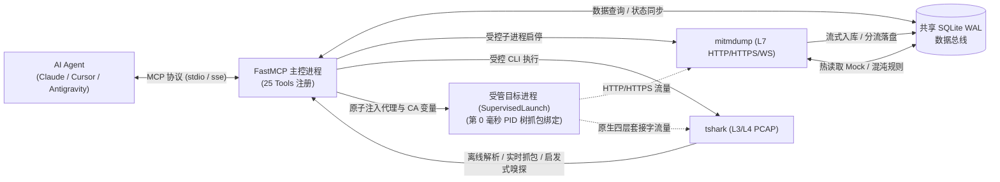

# atengk-mcp-server-traffic-inspector

<p align="center">
  <strong>专为 AI Agent / LLM 打造的网络流量抓包、会话检索、底层链路诊断、请求重放与规则 Mock 全功能 MCP Server</strong>
</p>

<p align="center">
  <a href="https://pypi.org/project/atengk-mcp-server-traffic-inspector/">
    
  </a>
  <a href="https://pypi.org/project/atengk-mcp-server-traffic-inspector/">
    
  </a>
  <a href="https://github.com/atengk/mcp-server-traffic-inspector/actions/workflows/ci.yml">
    
  </a>
  <a href="https://github.com/atengk/mcp-server-traffic-inspector/releases">
    
  </a>
  <a href="./LICENSE">
    
  </a>
  <a href="./CONTRIBUTING.md">
    
  </a>
</p>

---

## 📖 项目简介

`atengk-mcp-server-traffic-inspector` 是一款工业级全栈网络流量巡检与抓包 Model Context Protocol (MCP) Server。采用 **主控与受控子进程解耦架构**，基于共享 SQLite WAL 数据总线连接应用层（L7 `mitmproxy`）与传输层（L3/L4 `tshark`），为 AI Agent 赋予完整的网络流量观测、进程受管注入、混沌测试与排障闭环：



---

## ✨ 核心特性

- 🌐 **应用层 (L7) 流量拦截与操控**：基于受控 `mitmdump` 子进程捕获 HTTP/HTTPS 流量；支持多维条件分页检索（`query` 模糊过滤、`compact` 极简视图大幅节省 Token）、基于 `httpx` 的参数变异重放（Replay & Diff）及 SQLite 规则热同步非阻塞 Mock/改写。
- 💥 **网络混沌故障注入与时延仿真 (`ChaosInjection`)**：支持通过 `add_intercept_rule` 注入前置毫秒级网络延迟（`delay_ms`）、模拟物理连接异常瞬断（`action="abort"` / `flow.kill()`）与原子限次生效自动失活（`max_hits`），无缝赋能 Agent 开展客户端容错与降级演练。
- 🚀 **进程主动受管拉起与双轨捕获 (`SupervisedLaunch`)**：提供 `launch_and_inspect_process` 工具，在拉起 CLI 脚本、微服务瞬间原子级注入代理网络参数与非系统运行时 CA 环境变量，第 0 毫秒绑定 PID 树时空切片与双轨抓包，彻底解决启动期漏包与多实例端口混淆。
- ⚡ **长连接与 WebSocket 帧级全链路审计**：支持 WebSocket 双向消息帧捕获、自动抑制 PING/PONG 心跳帧干扰、超大载荷（>256KB）分流落盘；对齐 Chrome DevTools 规范导出 `_webSocketMessages` HAR 1.2 归档。
- 📡 **网络层 (L3/L4) 原始网卡抓包与深度分析**：集成 Wireshark `tshark` 引擎，支持网卡枚举、`loopback` 别名解析与 `auto` 多网卡协同捕获（`MultiInterfaceCapture`）、双重安全熔断（默认 2000 包 / 60 秒）的实时抓包及离线 PCAP 深度解析（TCP 重传率、RTT 时延、DNS 耗时）。
- 🧵 **Follow TCP Stream 会话流重组与启发式嗅探 (`HeuristicDissector`)**：从离线 PCAP 中自动提取唯一 TCP 会话流清单；按 Client/Server 交互时序回合（Turns）对齐 Wireshark 高保真重组；内置轻量启发式嗅探器，支持 TLS SNI 域名提取、HTTP/WebSocket 帧识别、Gzip/Zlib 尝试解压缩与 ASCII 连续可读文本提炼。
- 🩺 **全栈 SessionDiagnosis 智能根因诊断**：自动聚合慢请求 Top 5、互斥状态码分布及精确占比、高频端点、底层链路指标与 Sidecar 进程拓扑画像；双轨抓包下自动识别回环代理重定向（`ProxyRedirectionNotice`）与原生套接字流量（`RawSocketTraffic`）。
- 🛡️ **LLM 上下文防爆保护与宏观洞察**：列表检索严禁携带 Body，支持 `compact=True` 紧凑模式节约 75% Token；详情接口默认截断至 2048 字符预览；超大载荷（>256KB）自动分流至临时文件；检索首部提供 `summary_metrics` 快速洞察异常率与平均耗时。
- 📦 **标准 HAR 1.2 自动导出与归档**：停止抓包时自动将会话及无损载荷导出为标准 HAR 1.2 归档文件（防御空会话异常），完全兼容浏览器开发者工具与抓包软件导入。
- 🔌 **智能代理权属感知与 CA 免提权静默直装**：支持抓包启停自动接管 Windows 全局代理并在停止或退出时安全自愈（带权属校验，绝不误关第三方 Clash 代理）；Windows 平台支持当前用户受信任根证书库免 UAC 提权一键安装（`trust_ca_certificate`），并自动输出 Node.js / Python / Go 信任环境配置。

---

## 💡 AI Agent 常用交互提示词 (Prompt Examples)

配置完成后，您可以直接在 AI Agent 对话框（如 Cursor、Claude Desktop、Antigravity 等）中发送以下提示词。MCP Server 会引导 Agent 自主编排多工具链协同完成复杂抓包分析与诊断：

### 一、应用层 (L7) API 调试、重放、紧凑检索与混沌注入

#### 场景 1：HTTP/HTTPS 会话抓包与慢接口排查
> **用户提示词**：  
> “请帮我启动 HTTP 代理抓包，监听端口 8080，过滤域名 `api.mycompany.com`。随后我会发起业务调用，请帮我列出返回 4xx/5xx 或响应时间超过 1 秒的请求，并诊断其异常原因。”
* **协同工具链 (Workflow Intent)**：`start_http_capture` ➔ `list_http_flows` ➔ `get_http_flow_detail` ➔ `diagnose_network_session`

#### 场景 2：接口混沌延迟、物理断网仿真与限次容错演练 (ChaosInjection)
> **用户提示词**：  
> “请添加一条混沌拦截规则，对匹配 `*/v1/order/checkout*` 的请求前置注入 800ms 网络延迟，并模拟物理连接异常切断（`action="abort"`），且设定仅限次生效 3 次（`max_hits=3`）。随后帮我发起重试调用，检验客户端在遇到 3 次网络故障后是否能正确触发降级并在第 4 次自动恢复。”
* **协同工具链 (Workflow Intent)**：`add_intercept_rule(action="abort", delay_ms=800, max_hits=3)` ➔ `list_intercept_rules` ➔ `clear_intercept_rules`

#### 场景 3：历史请求参数变异重放与差异对比 (Replay & Diff)
> **用户提示词**：  
> “请查询最近一次会话中请求 `/v1/users/profile` 失败的流量 ID，将请求头中的 `Authorization` 替换为测试 Token `Bearer mock-token-123` 并重放该请求，对比新响应与旧响应在状态码和返回数据上的差异。”
* **协同工具链 (Workflow Intent)**：`list_http_flows` ➔ `replay_http_request`

#### 场景 4：海量流量下的极简紧凑检索与全局指标洞察 (Compact Mode)
> **用户提示词**：  
> “请以紧凑模式（`compact=True`）检索当前会话中 URL 包含 `checkout` 的流，不要返回冗长 Headers 以节约 Token。同时提取响应顶层的 `summary_metrics`，告诉我这次压测中的错误请求总数与平均接口响应时长。”
* **协同工具链 (Workflow Intent)**：`list_http_flows(compact=True, query="checkout")` ➔ `get_http_flow_detail`

---

### 二、受管进程双轨拉起与精准隔离

#### 场景 5：短生命周期脚本/CLI 的受管拉起与第 0 毫秒双轨抓包 (SupervisedLaunch)
> **用户提示词**：  
> “请使用受管模式拉起我的测试脚本 `python test_api.py`，自动为其注入 HTTP 代理和 CA 证书环境变量（防止 requests 报证书不信任错误），同步开启 PCAP 抓包并在进程退出后收集其控制台输出与网络抓包结果。”
* **协同工具链 (Workflow Intent)**：`trust_ca_certificate` ➔ `launch_and_inspect_process(command="python test_api.py", inject_proxy=True, inject_ca_cert=True, capture_pcap=True, wait_for_exit=True)`

#### 场景 6：目标进程家族精准隔离抓包与远程拓扑画像 (Process-Aware Capture)
> **用户提示词**：  
> “请监听本地 WLAN 网卡，仅针对可执行程序 `Weixin.exe` 及其衍生的所有子进程发起 30 秒的精准定向抓包，自动剔除系统其他软件的无关网络噪音。抓包结束后分析该程序通信的所有远端 IP 拓扑与流量吞吐占比。”
* **协同工具链 (Workflow Intent)**：`list_network_interfaces` ➔ `start_pcap_capture(process_name="Weixin.exe", include_child_processes=True)` ➔ `stop_pcap_capture` ➔ `diagnose_network_session`

---

### 三、长连接与传输层 (L3/L4) 协议深度审计

#### 场景 7：原始网卡抓包与底层协议链路诊断
> **用户提示词**：  
> “请查看当前主机的抓包网卡列表（使用友好名称如 WLAN），并在该网卡上启动 30 秒的 PCAP 抓包（过滤条件为 `tcp port 443`）。抓包完成后调用诊断工具，分析当前网络是否存在高 TCP 重传率或 RTT 延迟突增的情况。”
* **协同工具链 (Workflow Intent)**：`list_network_interfaces` ➔ `start_pcap_capture` ➔ `stop_pcap_capture` ➔ `analyze_pcap_file` ➔ `diagnose_network_session`

#### 场景 8：本地微服务回环通信与多网卡协同捕获 (MultiInterfaceCapture)
> **用户提示词**：  
> “我本地正在联调微服务集群，服务之间通过 127.0.0.1 回环通信且存在物理外网调用。请使用多网卡自动协同模式（`interface="auto"`）发起 30 秒抓包，并帮我排查是否存在回环原生套接字通信与网络拥塞。”
* **协同工具链 (Workflow Intent)**：`list_network_interfaces` ➔ `start_pcap_capture(interface="auto", duration_seconds=30)` ➔ `stop_pcap_capture` ➔ `diagnose_network_session`

#### 场景 9：WebSocket 长连接消息流审计与心跳过滤
> **用户提示词**：  
> “请帮我检索刚刚连接 `/ws/v1/feed` 的 WebSocket 握手流 ID，列出该连接收发的所有业务消息（自动过滤 PING/PONG 心跳帧）。并提取第 3 条推送消息的详细内容进行 JSON 解析，查看最新行情推送。”
* **协同工具链 (Workflow Intent)**：`list_http_flows` ➔ `list_websocket_messages` ➔ `get_websocket_message_detail`

#### 场景 10：PCAP 会话流重组与启发式协议嗅探 (HeuristicDissector)
> **用户提示词**：  
> “请分析本地抓包文件 `session.pcap`，列出其中的所有 TCP 会话流；定位到包含未知二进制交互的流后，调用 Follow TCP Stream 工具按回合（Turns）重组时序报文，并利用内置启发式嗅探提取 TLS SNI 域名、探测解压 Gzip 载荷并提取可读 ASCII 字符串。”
* **协同工具链 (Workflow Intent)**：`analyze_pcap_file` ➔ `list_tcp_streams` ➔ `follow_tcp_stream(stream_id=0, format="turns")`

---

### 四、自动化闭环、HAR 归档与系统环境运维

#### 场景 11：网络会话完整导出为标准 HAR 归档文件
> **用户提示词**：  
> “请将当前抓包会话的所有 HTTP 流量以及完整请求/响应 Body 导出为本地文件 `session_backup.har`，我要导入到 Charles 和 Chrome DevTools 中进行留存归档。”
* **协同工具链 (Workflow Intent)**：`export_http_session`

#### 场景 12：一键免提权托管全生命周期自愈抓包 (Auto-Lifecycle 闭环)
> **用户提示词**：  
> “帮我执行全自动抓包排障：免管理员提权将 CA 根证书导入当前用户受信任证书库，启动抓包并自动将系统全局代理设置为当前端口；待我通知或 1 分钟后停止抓包，停止时请自动复位系统代理并无损导出包含全部流量与 WebSocket 消息的 HAR 归档报告。”
* **协同工具链 (Workflow Intent)**：`trust_ca_certificate(system_wide=False)` ➔ `start_http_capture(auto_set_system_proxy=True)` ➔ `stop_http_capture(auto_export_har=True, restore_system_proxy=True)`

---

## 🛠️ 快速开始

### 方式 1：使用 `uvx` 免安装开箱即用（推荐）

无需手动克隆代码库，支持在各主流 MCP 客户端中一键接入：

#### 桌面 MCP 客户端配置

在客户端配置文件（如 `claude_desktop_config.json` 或各编辑器的 MCP 设置）中添加：

```json
{
  "mcpServers": {
    "traffic-inspector": {
      "command": "uvx",
      "args": [
        "atengk-mcp-server-traffic-inspector"
      ]
    }
  }
}
```

#### 配置文件路径参考
- **Claude Desktop (Windows)**: `%APPDATA%\Claude\claude_desktop_config.json`
- **Claude Desktop (macOS)**: `~/Library/Application Support/Claude/claude_desktop_config.json`
- **Cursor**: `Settings -> Cursor Settings -> Features -> MCP`
- **Windsurf**: `~/.codeium/windsurf/mcp_config.json`

---

### 方式 2：使用 Docker 容器化运行（内置 `tshark`）

Docker 镜像已内置 `tshark`、`uv` 及完整 Python 运行环境，开箱即具备全栈三/四层与七层抓包能力：

```bash
# 启动 SSE 模式容器 (8000 为 MCP 端口，8080 为 HTTP 代理端口)
docker run -d --name traffic-inspector \
  -p 8000:8000 \
  -p 8080:8080 \
  ghcr.io/atengk/mcp-server-traffic-inspector:latest

# 执行容器内运行环境自检
docker exec -it traffic-inspector mcp-server-traffic-inspector --check
```

---

### 方式 3：本地源码调试与开发

```bash
# 1. 克隆代码库并配置 Git 规范提交钩子
git clone https://github.com/atengk/mcp-server-traffic-inspector.git
cd mcp-server-traffic-inspector
git config core.hooksPath .githooks

# 2. 同步安装依赖
uv sync --all-extras --dev

# 3. 执行环境自检探针 (检查 Python、mitmdump、tshark 与 CA 状态)
uv run mcp-server-traffic-inspector --check

# 4. 启动本地 stdio 模式服务
uv run mcp-server-traffic-inspector
```

---

### 依赖要求 (Prerequisites)

| 功能模块 | Windows 依赖 | Linux 依赖 | macOS 依赖 | 说明 |
| :--- | :--- | :--- | :--- | :--- |
| **HTTP 代理抓包 (L7)** | Python 3.11+ (内置 mitmproxy) | Python 3.11+ | Python 3.11+ | 纯 Python 用户态实现，开箱即用 |
| **底层 PCAP 抓包 (L3/L4)** | Wireshark + Npcap | tshark + libpcap | Wireshark + libpcap | 需底层网络驱动支持 |
| **进程感知与拓扑审计** | Windows 原生 (含动态切片) | 优雅降级为网卡抓包 | 优雅降级为网卡抓包 | 自动发现进程树与多服务器画像 |

#### 抓包引擎快速安装命令
- **Windows**: `winget install WiresharkFoundation.Wireshark`（自动包含 tshark 与 Npcap）
- **Ubuntu/Debian**: `sudo apt-get install -y tshark`
- **macOS**: `brew install wireshark`

---

## 🧰 MCP Tools 能力矩阵 (25 Tools)

本服务完整实现了 **25 个 MCP Tools**，覆盖全栈网络流量观测、受管进程拉起、长连接审计、底层重组、混沌故障与运维排障的全生命周期：

| 领域模块 | 工具名称 | 核心参数 | 功能描述 |
| :--- | :--- | :--- | :--- |
| **受管进程拉起与双轨抓包** | `launch_and_inspect_process` | `command`, `cwd=None`, `extra_env=None`, `inject_proxy=True`, `inject_ca_cert=True`, `capture_pcap=False`, `pcap_interface='loopback'`, `wait_for_exit=False`, `timeout_seconds=30` | 主动拉起受管目标进程，原子级注入抓包代理与 CA 环境变量，支持第 0 毫秒双轨 PCAP 绑定与超时受控回收 |
| **HTTP 抓包生命周期** | `start_http_capture` | `port=8080`, `listen_host='0.0.0.0'`, `filter_host=None`, `auto_set_system_proxy=False` | 启动受控代理子进程，可联动托管系统代理；按需过滤目标域名并透明转发其他流量 |
| | `stop_http_capture` | `auto_export_har=True`, `restore_system_proxy=True`, `har_output_path=None` | 停止抓包代理，自动导出 HAR 1.2 归档并智能自愈系统代理（带权属校验，防误关外部代理） |
| | `get_capture_status` | 无 | 查询代理运行状态、监听端口、已捕获流数与运行时长 |
| **流量检索与详情** | `list_http_flows` | `session_id=None`, `host=None`, `query=None`, `status_code=None`, `status_family=None`, `method=None`, `min_duration_ms=None`, `sort_by='timestamp'`, `compact=False`, `limit=20`, `offset=0` | 多维分页检索请求流；支持 `query` 模糊搜索、`compact=True` 紧凑模式（节约 75% Token）及 `summary_metrics` 宏观指标 |
| | `get_http_flow_detail` | `flow_id`, `include_headers=True`, `include_body=True`, `max_body_chars=2048`, `dump_body_to_file=False` | 查看完整 Headers 与截断文本预览；支持强制导出无损原始文件 |
| **重放与规则 Mock / 混沌** | `replay_http_request` | `flow_id`, `modify_headers=None`, `modify_body=None`, `modify_url=None` | 基于历史 Flow 参数变异重放，无损读取原始大请求体并计算新旧响应 Diff |
| | `add_intercept_rule` | `url_pattern`, `action='mock'`, `mock_status=200`, `mock_headers=None`, `mock_body=None`, `modify_request_headers=None`, `modify_response_headers=None`, `delay_ms=0`, `max_hits=None` | 下发非阻塞动态规则，支持 Mock、Header 改写、毫秒级延迟注入（`delay_ms`）、物理瞬断（`action='abort'`）与限次自动失活（`max_hits`） |
| | `list_intercept_rules` | 无 | 查看当前生效的所有动态拦截、改写与混沌故障规则清单（含 `hit_count` 统计） |
| | `clear_intercept_rules` | `rule_id=None`（未传时清空全部） | 移除指定单条规则或清空全部动态拦截规则 |
| **长连接与 WebSocket** | `list_websocket_messages` | `flow_id=None`, `session_id=None`, `include_heartbeats=False`, `limit=100`, `offset=0` | 分页检索 WebSocket 消息帧；**默认自动抑制 PING/PONG 心跳帧干扰** |
| | `get_websocket_message_detail` | `message_id`, `max_body_chars=2048`, `dump_to_file=False` | 查看单帧完整文本内容、Opcode 属性与分流大载荷（>256KB）落盘文件路径 |
| **网络层 PCAP 抓包与嗅探** | `list_network_interfaces` | 无 | 枚举网卡索引、设备名、描述与友好别名 `friendly_name`（如 `WLAN`、`以太网`） |
| | `start_pcap_capture` | `interface=1`, `output_path=None`, `bpf_filter=None`, `max_packets=2000`, `duration_seconds=60`, `process_path=None`, `process_name=None`, `target_pids=None`, `include_child_processes=True`, `keep_raw_pcap=False` | 启动网卡实时抓包，支持 `interface='loopback'` 跨平台回环适配、`interface='auto'` 多网卡协同捕获、进程家族过滤与双重安全熔断 |
| | `stop_pcap_capture` | 无 | 停止抓包并返回生成的 `.pcap` 文件、数据包统计、进程家族与多服务器拓扑画像 |
| | `analyze_pcap_file` | `file_path`, `display_filter=None`, `limit=50` | 深度分析 PCAP 协议占比、TCP 重传率、RTT 与 DNS；自动加载 Sidecar 进程画像 |
| | `list_tcp_streams` | `file_path`, `limit=50` | 从离线 PCAP 中提取所有唯一 TCP 会话流端点、包数、字节数及 TLS SNI/Host 域名 |
| | `follow_tcp_stream` | `file_path`, `stream_id`, `format='turns'` | 高保真重组 TCP 流回合报文；内置启发式嗅探器（提取 TLS SNI、探测解压 Gzip/Zlib、提炼可读 ASCII 文本） |
| **全栈分析与诊断** | `analyze_http_traffic` | `session_id=None`（默认最近会话） | 聚合慢请求 Top 5、互斥状态码分布及精确占比、高频端点 Top 10 与大载荷消耗 |
| | `diagnose_network_session` | `session_type='http'\|'pcap'`, `target=None` | 自动计算链路健康度评分（0~100），精准识别代理重定向（`ProxyRedirectionNotice`）与原生套接字流量（`RawSocketTraffic`）并给出根因建议 |
| **CA 证书与系统代理托管** | `trust_ca_certificate` | `system_wide=False` | 将 mitmproxy CA 根证书导入系统信任库（Windows 默认免提权导入当前用户库），自动生成 Node/Python/Go 信任环境变量 |
| | `get_ca_certificate` | `install_to_system=False` | 定位 `mitmproxy` 本地 CA 证书路径与多平台信任安装指引；Windows 下支持自动导入 |
| | `toggle_system_proxy` | `enable: bool`, `port=8080`, `host='127.0.0.1'` | Windows 注册表代理托管；**主控退出时自动安全还原防断网**；非 Windows 优雅降级指引 |
| | `get_system_proxy_status` | `port=8080`, `host='127.0.0.1'` | 主动探测宿主机当前系统全局代理状态、配置参数及其与本服务端口的归属绑定关系 |
| | `export_http_session` | `output_path`, `session_id=None`, `format='har'` | 将会话全部流、保真载荷及 WebSocket 帧导出为标准 HAR 1.2 归档文件 |

---

## ⚙️ CLI 命令行参数与环境变量

命令执行参数优先级严格遵循：**CLI 命令行参数 > `MCP_TRAFFIC_INSPECTOR_*` 环境变量 > 内置默认值**。

| CLI 选项 | 对应环境变量 | 默认值 | 详细说明 |
| :--- | :--- | :--- | :--- |
| `-h, --help` | - | - | 输出命令行参数说明与帮助文档并退出 |
| `-v, --version` | - | - | 输出当前版本号并退出 |
| `--check` / `--doctor` | - | `False` | 运行环境自检探针，检查依赖与权限后按健康状态退出（退出码 0 或 1） |
| `-t, --transport` | `MCP_TRAFFIC_INSPECTOR_TRANSPORT` | `stdio` | MCP 传输协议：`stdio`、`sse`、`streamable-http` |
| `--host` | `MCP_TRAFFIC_INSPECTOR_HOST` | `127.0.0.1` | 在 `sse` 或 `streamable-http` 模式下绑定的监听地址 |
| `-p, --port` | `MCP_TRAFFIC_INSPECTOR_PORT` | `8000` | 在 `sse` 或 `streamable-http` 模式下绑定的监听端口 |
| `--tshark-path` | `MCP_TRAFFIC_INSPECTOR_TSHARK_PATH` | 自动探测 | 显式指定 `tshark` 可执行文件绝对路径 |
| `--db-path` | `MCP_TRAFFIC_INSPECTOR_DB_PATH` | 系统临时目录 | 显式指定 SQLite 数据库路径（**指定路径时退出后保留该数据库文件**） |
| `--log-level` | `MCP_TRAFFIC_INSPECTOR_LOG_LEVEL` | `INFO` | 日志级别（`DEBUG`、`INFO`、`WARNING`、`ERROR`）；`stdio` 模式强制输出至 `stderr` |

---

## 🩺 环境自检与常见排障 (Doctor & FAQ)

### 1. 一键运行环境自检探针 (Doctor)
在部署或排查故障前，可执行 `--check` / `--doctor` 参数对当前宿主机的 Python、`mitmdump`、`tshark`、CA 证书与临时存储权限进行端到端自检：
```bash
# 使用 uvx 免安装快速体检
uvx atengk-mcp-server-traffic-inspector --check
```
探针将输出包含依赖路径、版本、CA 证书存在性与临时目录权限的结构化诊断报告（退出码 0 表示就绪，1 表示存在阻塞性依赖缺失）。

### 2. 抓取 HTTPS 请求提示证书不信任或 TLS 握手失败？
* **Windows 一键静默自动导入**：直接通过 AI Agent 调用 `get_ca_certificate(install_to_system=True)`，服务将自动调用系统 `certutil` 静默安装至当前用户的「受信任的根证书颁发机构」，无需手动操作命令行。
* **手动安装指引**：
  * **Windows**：双击证书文件并导入至“受信任的根证书颁发机构”存储区。
  * **Linux**：`sudo cp "<ca_cert_path>" /usr/local/share/ca-certificates/mitmproxy.crt && sudo update-ca-certificates`。
  * **macOS**：`sudo security add-trusted-cert -d -r trustRoot -k /Library/Keychains/System.keychain "<ca_cert_path>"`。

### 3. Windows 下开启系统代理后，服务异常退出会导致断网吗？
* **绝不会**。`mcp-server-traffic-inspector` 具备双重自愈机制：
  1. **主动生命周期管理**：主控进程绑定了 `atexit` 与信号处理器（`SIGINT`/`SIGTERM`），退出时自动复位代理注册表。
  2. **智能权属校验 (Proxy Ownership Check)**：复位前校验当前代理是否确实指向本服务的 IP 与端口，**绝不误关第三方代理（如 Clash、v2ray 等）**。

### 4. 双轨抓包时，为什么 PCAP 抓不到 HTTP 80 / 443 的网络包？
* **这是正常且预期的网络行为**：当开启 HTTP 代理时，操作系统的应用层流量会被直接重定向至本地环回地址（`127.0.0.1:8080`），而不再流经物理网卡（如 WLAN）。
* **智能感知机制**：系统的 `diagnose_network_session` 工具内置了 `ProxyRedirectionNotice` 诊断感知逻辑，会自动检测并提示该回环重定向现象，引导您查看应用层 HTTP 流而非误判为网络丢包。

### 5. 提示 `tshark` 未找到或缺少 Npcap 驱动？
* **Windows**：
  1. 请安装 [Wireshark](https://www.wireshark.org/)，安装过程中**务必勾选安装 Npcap 驱动**（底层网卡抓包核心依赖）。
  2. 默认安装路径通常为 `C:\Program Files\Wireshark\tshark.exe`；若安装在自定义路径，可通过环境变量 `MCP_TRAFFIC_INSPECTOR_TSHARK_PATH` 或 CLI 参数 `--tshark-path` 显式指定。
* **Linux (Ubuntu/Debian)**：`sudo apt-get update && sudo apt-get install -y tshark`。
* **Docker 容器**：直接使用官方镜像 `ghcr.io/atengk/mcp-server-traffic-inspector`，镜像内部已预装全部完整驱动与工具链。

### 6. 在 Linux、macOS 或 Docker 容器中如何使客户端流量经过代理？
* 在无注册表环境（Linux/macOS/Docker）下，请通过标准环境变量配置客户端代理：
  ```bash
  export http_proxy=http://127.0.0.1:8080
  export https_proxy=http://127.0.0.1:8080
  ```

### 7. 运行 Node.js / Python requests / Go 脚本抓包时提示证书不信任？
* **非系统根证书库机制**：Node.js、Python `requests`、Go 与 Curl 等工具链默认使用内置或独立的 CA Bundle，不直接读取操作系统注册表信任库。
* **解决方案 A（推荐，受管一键拉起）**：直接通过 `launch_and_inspect_process(command="node app.js")` 拉起脚本，系统会在第 0 毫秒自动注入 `NODE_EXTRA_CA_CERTS`、`SSL_CERT_FILE`、`REQUESTS_CA_BUNDLE` 与 `CURL_CA_BUNDLE`，无需手动配置。
* **解决方案 B（手动配置环境变量）**：
  ```bash
  # Windows PowerShell
  $env:NODE_EXTRA_CA_CERTS = "$HOME\.mitmproxy\mitmproxy-ca-cert.pem"
  $env:SSL_CERT_FILE = "$HOME\.mitmproxy\mitmproxy-ca-cert.pem"
  $env:REQUESTS_CA_BUNDLE = "$HOME\.mitmproxy\mitmproxy-ca-cert.pem"

  # Linux / macOS
  export NODE_EXTRA_CA_CERTS="$HOME/.mitmproxy/mitmproxy-ca-cert.pem"
  export SSL_CERT_FILE="$HOME/.mitmproxy/mitmproxy-ca-cert.pem"
  export REQUESTS_CA_BUNDLE="$HOME/.mitmproxy/mitmproxy-ca-cert.pem"
  ```

### 8. Windows 环境下没有管理员提权权限，如何抓取 HTTPS 流量？
* **免 UAC 提权设计**：服务提供了 `trust_ca_certificate(system_wide=False)` 工具，其底层调用 `certutil -user -addstore Root`，将 CA 根证书写入 Windows 当前登录用户的受信任根证书库（`CurrentUser\Root`）。
* **权限透明**：无需弹出 UAC 提权确认框，不会修改系统全局配置，但足以让当前用户运行的所有主流浏览器（Chrome、Edge）及 WinINet 协议栈程序信任抓包证书。

### 9. 抓取本地微服务回环通信或私有协议时，网卡应该如何选择？
* **Loopback 虚拟适配器**：本地服务间若通过 `127.0.0.1` 或 `localhost` 互相调用，流量不会经过物理网卡（如以太网或 WLAN）。在 `start_pcap_capture` 中直接传入 `interface="loopback"`，服务在 Windows 下将自动定位 Npcap 的 `\Device\NPF_Loopback` 虚拟网卡，在 Linux/macOS 下映射至 `lo`/`lo0`。
* **多网卡协同捕获 (MultiInterfaceCapture)**：若服务既有内网回环通信又有物理外网调用，传入 `interface="auto"`，底层将基于 Tshark 原生多 `-i` 机制并发监听全部活跃接口，按纳秒时序将全部原生套接字流量聚合入单一 PCAP 报文文件。

---

## 🤝 参与贡献

欢迎任何形式的贡献、建议与 Issue 反馈！请在提交代码前仔细阅读我们的 [贡献指南 (CONTRIBUTING.md)](./CONTRIBUTING.md)。

---

## 📄 开源许可证

本项目基于 [Apache License 2.0](./LICENSE) 协议开源。
