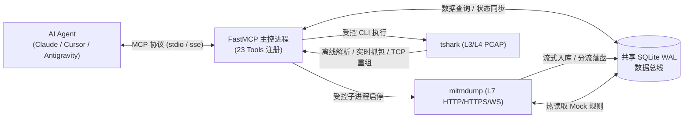

# atengk-mcp-server-traffic-inspector

<p align="center">
  <strong>专为 AI Agent / LLM 打造的网络流量抓包、会话检索、底层链路诊断、请求重放与规则 Mock 全功能 MCP Server</strong>
</p>

<p align="center">
  <a href="https://pypi.org/project/atengk-mcp-server-traffic-inspector/">
    
  </a>
  <a href="https://pypi.org/project/atengk-mcp-server-traffic-inspector/">
    
  </a>
  <a href="https://github.com/atengk/mcp-server-traffic-inspector/actions/workflows/ci.yml">
    
  </a>
  <a href="https://github.com/atengk/mcp-server-traffic-inspector/releases">
    
  </a>
  <a href="./LICENSE">
    
  </a>
  <a href="./CONTRIBUTING.md">
    
  </a>
</p>

---

## 📖 项目简介

`atengk-mcp-server-traffic-inspector` 是一款工业级全栈网络流量巡检与抓包 Model Context Protocol (MCP) Server。采用 **主控与受控子进程解耦架构**，基于共享 SQLite WAL 数据总线连接应用层（L7 `mitmproxy`）与传输层（L3/L4 `tshark`），为 AI Agent 赋予完整的网络流量观测与排障闭环：



---

## ✨ 核心特性

- 🌐 **应用层 (L7) 流量拦截与操控**：基于受控 `mitmdump` 子进程捕获 HTTP/HTTPS 流量；支持多条件分页检索、基于 `httpx` 的参数变异重放（Replay & Diff）及 SQLite 规则热同步非阻塞 Mock/改写。
- ⚡ **长连接与 WebSocket 帧级全链路审计**：支持 WebSocket 双向消息帧捕获、自动抑制 PING/PONG 心跳帧干扰、超大载荷（>256KB）分流落盘；对齐 Chrome DevTools 规范导出 `_webSocketMessages` HAR 1.2 归档。
- 📡 **网络层 (L3/L4) 原始网卡抓包与深度分析**：集成 Wireshark `tshark` 引擎，支持网卡枚举、双重安全熔断（默认 2000 包 / 60 秒）的实时抓包及离线 PCAP 深度解析（TCP 重传率、RTT 时延、DNS 耗时）。
- 🧵 **Follow TCP Stream 会话流重组与提取**：从离线 PCAP 中自动提取唯一 TCP 会话流清单（含 TLS SNI / HTTP Host），并支持按 Client/Server 交互时序回合（Turns）对齐 Wireshark 高保真重组与 Hex 提取。
- 🩺 **全栈 SessionDiagnosis 智能根因诊断**：自动聚合慢请求 Top 5、互斥状态码分布及精确占比、高频端点、底层链路指标与 Sidecar 进程拓扑画像；双轨抓包下自动识别回环代理重定向。
- 🛡️ **LLM 上下文防爆保护**：列表检索严禁携带 Body；详情接口默认截断至 2048 字符预览；超大载荷（>256KB）自动分流至临时文件，支持一键落盘原始无损文件。
- 📦 **标准 HAR 1.2 自动导出与归档**：停止抓包时自动将会话及无损载荷导出为标准 HAR 1.2 归档文件（防御空会话异常），完全兼容浏览器开发者工具与抓包软件导入。
- 🔌 **智能代理权属感知与 CA 一键静默直装**：支持抓包启停自动接管 Windows 全局代理并在停止或退出时安全自愈（带权属校验，绝不误关第三方 Clash 代理）；Windows 下支持 `certutil` 一键自动导入受信任 CA 证书。

---

## 💡 AI Agent 常用交互提示词 (Prompt Examples)

配置完成后，您可以直接在 AI Agent 对话框（如 Cursor、Claude Desktop、Antigravity 等）中发送以下提示词。MCP Server 会引导 Agent 自主编排多工具链协同完成复杂抓包分析与诊断：

### 一、应用层 (L7) API 调试、重放与故障注入

#### 场景 1：HTTP/HTTPS 会话抓包与慢接口排查
> **用户提示词**：  
> “请帮我启动 HTTP 代理抓包，监听端口 8080，过滤域名 `api.mycompany.com`。随后我会发起业务调用，请帮我列出返回 4xx/5xx 或响应时间超过 1 秒的请求，并诊断其异常原因。”
* **协同工具链 (Workflow Intent)**：`start_http_capture` ➔ `list_http_flows` ➔ `get_http_flow_detail` ➔ `diagnose_network_session`

#### 场景 2：接口故障注入与非阻塞 Mock 模拟
> **用户提示词**：  
> “请添加一条 Mock 拦截规则，将所有匹配 `*/v1/order/checkout*` 的请求拦截并直接返回 HTTP 500 状态码，响应正文为 `{"error": "ORDER_TIMEOUT", "message": "支付网关超时"}`，方便我测试客户端的降级容灾逻辑。”
* **协同工具链 (Workflow Intent)**：`add_intercept_rule` ➔ `list_intercept_rules` ➔ `clear_intercept_rules`

#### 场景 3：历史请求参数变异重放与差异对比 (Replay & Diff)
> **用户提示词**：  
> “请查询最近一次会话中请求 `/v1/users/profile` 失败的流量 ID，将请求头中的 `Authorization` 替换为测试 Token `Bearer mock-token-123` 并重放该请求，对比新响应与旧响应在状态码和返回数据上的差异。”
* **协同工具链 (Workflow Intent)**：`list_http_flows` ➔ `replay_http_request`

---

### 二、长连接与传输层 (L3/L4) 协议深度审计

#### 场景 4：原始网卡抓包与底层协议链路诊断
> **用户提示词**：  
> “请查看当前主机的抓包网卡列表（使用友好名称如 WLAN），并在该网卡上启动 30 秒的 PCAP 抓包（过滤条件为 `tcp port 443`）。抓包完成后调用诊断工具，分析当前网络是否存在高 TCP 重传率或 RTT 延迟突增的情况。”
* **协同工具链 (Workflow Intent)**：`list_network_interfaces` ➔ `start_pcap_capture` ➔ `stop_pcap_capture` ➔ `analyze_pcap_file` ➔ `diagnose_network_session`

#### 场景 5：WebSocket 长连接消息流审计与心跳过滤
> **用户提示词**：  
> “请帮我检索刚刚连接 `/ws/v1/feed` 的 WebSocket 握手流 ID，列出该连接收发的所有业务消息（自动过滤 PING/PONG 心跳帧）。并提取第 3 条推送消息的详细内容进行 JSON 解析，查看最新行情推送。”
* **协同工具链 (Workflow Intent)**：`list_http_flows` ➔ `list_websocket_messages` ➔ `get_websocket_message_detail`

#### 场景 6：PCAP 原始报文会话流提取与 Follow TCP Stream 回合追踪
> **用户提示词**：  
> “请分析本地抓包文件 `session.pcap`，先列出其中的全部 TCP 会话流清单；定位到指向端口 443 或 80 的会话流后，调用 Follow TCP Stream 工具按交互回合（Turns）重组并展示客户端与服务端的时序报文，帮我排查中间是否存在协议畸变或传输断连。”
* **协同工具链 (Workflow Intent)**：`analyze_pcap_file` ➔ `list_tcp_streams` ➔ `follow_tcp_stream`

#### 场景 7：目标进程家族精准隔离抓包与远程拓扑画像 (Process-Aware Capture)
> **用户提示词**：  
> “请监听本地 WLAN 网卡，仅针对可执行程序 `Weixin.exe` 及其衍生的所有子进程发起 30 秒的精准定向抓包，自动剔除系统其他软件的无关网络噪音。抓包结束后分析该程序通信的所有远端 IP 拓扑与流量吞吐占比。”
* **协同工具链 (Workflow Intent)**：`list_network_interfaces` ➔ `start_pcap_capture(process_name="Weixin.exe", include_child_processes=True)` ➔ `stop_pcap_capture` ➔ `diagnose_network_session`

---

### 三、自动化闭环、HAR 归档与系统环境运维

#### 场景 8：网络会话完整导出为标准 HAR 归档文件
> **用户提示词**：  
> “请将当前抓包会话的所有 HTTP 流量以及完整请求/响应 Body 导出为本地文件 `session_backup.har`，我要导入到 Charles 和 Chrome DevTools 中进行留存归档。”
* **协同工具链 (Workflow Intent)**：`export_http_session`

#### 场景 9：一键静默托管全生命周期自愈抓包 (Auto-Lifecycle 闭环)
> **用户提示词**：  
> “帮我执行全自动抓包排障：自动检查并在 Windows 上安装受信任 CA 证书，启动抓包并自动将系统全局代理设置为当前端口；待我通知或 1 分钟后停止抓包，停止时请自动复位系统代理并无损导出包含全部流量与 WebSocket 消息的 HAR 归档报告。”
* **协同工具链 (Workflow Intent)**：`get_ca_certificate(install_to_system=True)` ➔ `start_http_capture(auto_set_system_proxy=True)` ➔ `stop_http_capture(auto_export_har=True, restore_system_proxy=True)`

#### 场景 10：操作系统全局代理冲突探查与自愈诊断 (Proxy Conflict Sensing)
> **用户提示词**：  
> “请主动探查当前操作系统的全局代理配置状态，检查当前网络流量是否指向了其他第三方代理（如 Clash 或 Fiddler），并排查是否存在代理回环死锁或双轨重定向风险，给出当前网络拓扑健康度诊断。”
* **协同工具链 (Workflow Intent)**：`get_system_proxy_status` ➔ `diagnose_network_session`

---

## 🛠️ 快速开始

### 方式 1：使用 `uvx` 免安装开箱即用（推荐）

无需手动克隆代码库，支持在各主流 MCP 客户端中一键接入：

#### 桌面 MCP 客户端配置

在客户端配置文件（如 `claude_desktop_config.json` 或各编辑器的 MCP 设置）中添加：

```json
{
  "mcpServers": {
    "traffic-inspector": {
      "command": "uvx",
      "args": [
        "atengk-mcp-server-traffic-inspector"
      ]
    }
  }
}
```

#### 配置文件路径参考
- **Claude Desktop (Windows)**: `%APPDATA%\Claude\claude_desktop_config.json`
- **Claude Desktop (macOS)**: `~/Library/Application Support/Claude/claude_desktop_config.json`
- **Cursor**: `Settings -> Cursor Settings -> Features -> MCP`
- **Windsurf**: `~/.codeium/windsurf/mcp_config.json`

---

### 方式 2：使用 Docker 容器化运行（内置 `tshark`）

Docker 镜像已内置 `tshark`、`uv` 及完整 Python 运行环境，开箱即具备全栈三/四层与七层抓包能力：

```bash
# 启动 SSE 模式容器 (8000 为 MCP 端口，8080 为 HTTP 代理端口)
docker run -d --name traffic-inspector \
  -p 8000:8000 \
  -p 8080:8080 \
  ghcr.io/atengk/mcp-server-traffic-inspector:latest

# 执行容器内运行环境自检
docker exec -it traffic-inspector mcp-server-traffic-inspector --check
```

---

### 方式 3：本地源码调试与开发

```bash
# 1. 克隆代码库并配置 Git 规范提交钩子
git clone https://github.com/atengk/mcp-server-traffic-inspector.git
cd mcp-server-traffic-inspector
git config core.hooksPath .githooks

# 2. 同步安装依赖
uv sync --all-extras --dev

# 3. 执行环境自检探针 (检查 Python、mitmdump、tshark 与 CA 状态)
uv run mcp-server-traffic-inspector --check

# 4. 启动本地 stdio 模式服务
uv run mcp-server-traffic-inspector
```

---

### 依赖要求 (Prerequisites)

| 功能模块 | Windows 依赖 | Linux 依赖 | macOS 依赖 | 说明 |
| :--- | :--- | :--- | :--- | :--- |
| **HTTP 代理抓包 (L7)** | Python 3.11+ (内置 mitmproxy) | Python 3.11+ | Python 3.11+ | 纯 Python 用户态实现，开箱即用 |
| **底层 PCAP 抓包 (L3/L4)** | Wireshark + Npcap | tshark + libpcap | Wireshark + libpcap | 需底层网络驱动支持 |
| **进程感知与拓扑审计** | Windows 原生 (含动态切片) | 优雅降级为网卡抓包 | 优雅降级为网卡抓包 | 自动发现进程树与多服务器画像 |

#### 抓包引擎快速安装命令
- **Windows**: `winget install WiresharkFoundation.Wireshark`（自动包含 tshark 与 Npcap）
- **Ubuntu/Debian**: `sudo apt-get install -y tshark`
- **macOS**: `brew install wireshark`

---

## 🧰 MCP Tools 能力矩阵 (23 Tools)

本服务完整实现了 **23 个 MCP Tools**，覆盖全栈网络流量观测、长连接审计、底层重组与排障的全生命周期：

| 领域模块 | 工具名称 | 核心参数 | 功能描述 |
| :--- | :--- | :--- | :--- |
| **HTTP 抓包生命周期** | `start_http_capture` | `listen_port=8080`, `filter_host=None`, `auto_set_system_proxy=False` | 启动受控代理子进程，可联动托管系统代理；按需过滤目标域名并透明转发其他流量 |
| | `stop_http_capture` | `auto_export_har=True`, `restore_system_proxy=True`, `har_output_path=None` | 停止抓包代理，自动导出 HAR 1.2 归档并智能自愈系统代理（带权属校验，防误关外部代理） |
| | `get_capture_status` | 无 | 查询代理运行状态、监听端口、已捕获流数与运行时长 |
| **流量检索与详情** | `list_http_flows` | `session_id`, `host`, `status_code`, `status_family`, `method`, `min_duration_ms`, `sort_by`, `limit`, `offset` | 多维条件分页检索请求流摘要；**绝不携带任何 Body，保证 LLM 上下文轻量** |
| | `get_http_flow_detail` | `flow_id`, `include_headers=True`, `include_body=True`, `max_body_chars=2048`, `dump_body_to_file=False` | 查看完整 Headers 与截断文本预览；支持强制导出无损原始文件 |
| **WebSocket 长连接审计** | `list_websocket_messages` | `flow_id=None`, `session_id=None`, `include_heartbeats=False`, `limit=100`, `offset=0` | 分页检索 WebSocket 消息帧；**默认自动抑制 PING/PONG 心跳帧干扰** |
| | `get_websocket_message_detail` | `message_id`, `max_body_chars=2048`, `dump_to_file=False` | 查看单帧完整文本内容、Opcode 属性与分流大载荷（>256KB）落盘文件路径 |
| **全栈分析与诊断** | `analyze_http_traffic` | `session_id=None`（默认最近会话） | 聚合慢请求 Top 5、互斥状态码分布及精确占比、高频端点 Top 10 与大载荷消耗 |
| | `diagnose_network_session` | `session_type="http"\|"pcap"`, `target=None` | 自动计算链路健康度评分（0~100），识别回环重定向并输出明确异常排障建议 |
| **PCAP 原始抓包与重组** | `list_network_interfaces` | 无 | 枚举网卡索引、设备名、描述与友好别名 `friendly_name`（如 `WLAN`、`以太网`） |
| | `start_pcap_capture` | `interface=1`, `process_path=None`, `process_name=None`, `target_pids=None`, `bpf_filter=None`, `keep_raw_pcap=False` | 启动网卡或目标进程树实时抓包，支持友好别名匹配、时空切片与双重安全熔断 |
| | `stop_pcap_capture` | 无 | 停止抓包并返回生成的 `.pcap` 文件、数据包统计、进程家族与多服务器拓扑画像 |
| | `analyze_pcap_file` | `file_path`, `display_filter=None`, `limit=50` | 深度分析 PCAP 协议占比、TCP 重传率、RTT 与 DNS；自动加载 Sidecar 进程画像 |
| | `list_tcp_streams` | `file_path`, `limit=50` | 从离线 PCAP 中提取所有唯一 TCP 会话流端点、包数、字节数及 TLS SNI/Host 域名 |
| | `follow_tcp_stream` | `file_path`, `stream_id`, `format="turns"` | 高保真重组 TCP 流交互数据，按 Client/Server 交互回合（Turns）对齐 Wireshark 追踪 |
| **重放与规则 Mock** | `replay_http_request` | `flow_id`, `modify_headers=None`, `modify_body=None`, `modify_url=None` | 基于历史 Flow 参数变异重放，无损读取原始大请求体并计算新旧响应 Diff |
| | `add_intercept_rule` | `url_pattern`, `action="mock"\|"modify"`, `mock_status=200`, `mock_headers`, `mock_body`, `modify_request_headers`, `modify_response_headers` | 下发非阻塞动态规则，支持 Mock 短路返回与请求/响应头动态改写 |
| | `list_intercept_rules` | 无 | 查看当前生效的所有动态拦截与改写规则清单 |
| | `clear_intercept_rules` | `rule_id=None`（未传时清空全部） | 移除指定单条规则或清空全部动态拦截规则 |
| **系统代理与运维** | `get_ca_certificate` | `install_to_system=False` | 定位 `mitmproxy` 本地 CA 证书路径；Windows 下支持一键自动安装至受信任根证书库 |
| | `toggle_system_proxy` | `enable: bool`, `port=8080`, `host="127.0.0.1"` | Windows 注册表代理托管；**主控退出时自动安全还原防断网**；非 Windows 降级指引 |
| | `get_system_proxy_status` | `port=8080`, `host="127.0.0.1"` | 主动探测宿主机当前系统全局代理状态、配置参数及其与本服务端口的归属关系 |
| | `export_http_session` | `output_path`, `session_id=None`, `format="har"` | 将会话全部流、保真载荷及 WebSocket 帧导出为标准 HAR 1.2 归档 |

---

## ⚙️ CLI 命令行参数与环境变量

命令执行参数优先级严格遵循：**CLI 命令行参数 > `MCP_TRAFFIC_INSPECTOR_*` 环境变量 > 内置默认值**。

| CLI 选项 | 对应环境变量 | 默认值 | 详细说明 |
| :--- | :--- | :--- | :--- |
| `-h, --help` | - | - | 输出命令行参数说明与帮助文档并退出 |
| `-v, --version` | - | - | 输出当前版本号并退出 |
| `--check` / `--doctor` | - | `False` | 运行环境自检探针，检查依赖与权限后按健康状态退出（退出码 0 或 1） |
| `-t, --transport` | `MCP_TRAFFIC_INSPECTOR_TRANSPORT` | `stdio` | MCP 传输协议：`stdio`、`sse`、`streamable-http` |
| `--host` | `MCP_TRAFFIC_INSPECTOR_HOST` | `127.0.0.1` | 在 `sse` 或 `streamable-http` 模式下绑定的监听地址 |
| `-p, --port` | `MCP_TRAFFIC_INSPECTOR_PORT` | `8000` | 在 `sse` 或 `streamable-http` 模式下绑定的监听端口 |
| `--tshark-path` | `MCP_TRAFFIC_INSPECTOR_TSHARK_PATH` | 自动探测 | 显式指定 `tshark` 可执行文件绝对路径 |
| `--db-path` | `MCP_TRAFFIC_INSPECTOR_DB_PATH` | 系统临时目录 | 显式指定 SQLite 数据库路径（**指定路径时退出后保留该数据库文件**） |
| `--log-level` | `MCP_TRAFFIC_INSPECTOR_LOG_LEVEL` | `INFO` | 日志级别（`DEBUG`、`INFO`、`WARNING`、`ERROR`）；`stdio` 模式强制输出至 `stderr` |

---

## 🩺 环境自检与常见排障 (Doctor & FAQ)

### 1. 一键运行环境自检探针 (Doctor)
在部署或排查故障前，可执行 `--check` / `--doctor` 参数对当前宿主机的 Python、`mitmdump`、`tshark`、CA 证书与临时存储权限进行端到端自检：
```bash
# 使用 uvx 免安装快速体检
uvx atengk-mcp-server-traffic-inspector --check
```
探针将输出包含依赖路径、版本、CA 证书存在性与临时目录权限的结构化诊断报告（退出码 0 表示就绪，1 表示存在阻塞性依赖缺失）。

### 2. 抓取 HTTPS 请求提示证书不信任或 TLS 握手失败？
* **Windows 一键静默自动导入**：直接通过 AI Agent 调用 `get_ca_certificate(install_to_system=True)`，服务将自动调用系统 `certutil` 静默安装至当前用户的「受信任的根证书颁发机构」，无需手动操作命令行。
* **手动安装指引**：
  * **Windows**：双击证书文件并导入至“受信任的根证书颁发机构”存储区。
  * **Linux**：`sudo cp "<ca_cert_path>" /usr/local/share/ca-certificates/mitmproxy.crt && sudo update-ca-certificates`。
  * **macOS**：`sudo security add-trusted-cert -d -r trustRoot -k /Library/Keychains/System.keychain "<ca_cert_path>"`。

### 3. Windows 下开启系统代理后，服务异常退出会导致断网吗？
* **绝不会**。`mcp-server-traffic-inspector` 具备双重自愈机制：
  1. **主动生命周期管理**：主控进程绑定了 `atexit` 与信号处理器（`SIGINT`/`SIGTERM`），退出时自动复位代理注册表。
  2. **智能权属校验 (Proxy Ownership Check)**：复位前校验当前代理是否确实指向本服务的 IP 与端口，**绝不误关第三方代理（如 Clash、v2ray 等）**。

### 4. 双轨抓包时，为什么 PCAP 抓不到 HTTP 80 / 443 的网络包？
* **这是正常且预期的网络行为**：当开启 HTTP 代理时，操作系统的应用层流量会被直接重定向至本地环回地址（`127.0.0.1:8080`），而不再流经物理网卡（如 WLAN）。
* **智能感知机制**：系统的 `diagnose_network_session` 工具内置了 `ProxyRedirectionNotice` 诊断感知逻辑，会自动检测并提示该回环重定向现象，引导您查看应用层 HTTP 流而非误判为网络丢包。

### 5. 提示 `tshark` 未找到或缺少 Npcap 驱动？
* **Windows**：
  1. 请安装 [Wireshark](https://www.wireshark.org/)，安装过程中**务必勾选安装 Npcap 驱动**（底层网卡抓包核心依赖）。
  2. 默认安装路径通常为 `C:\Program Files\Wireshark\tshark.exe`；若安装在自定义路径，可通过环境变量 `MCP_TRAFFIC_INSPECTOR_TSHARK_PATH` 或 CLI 参数 `--tshark-path` 显式指定。
* **Linux (Ubuntu/Debian)**：`sudo apt-get update && sudo apt-get install -y tshark`。
* **Docker 容器**：直接使用官方镜像 `ghcr.io/atengk/mcp-server-traffic-inspector`，镜像内部已预装全部完整驱动与工具链。

### 6. 在 Linux、macOS 或 Docker 容器中如何使客户端流量经过代理？
* 在无注册表环境（Linux/macOS/Docker）下，请通过标准环境变量配置客户端代理：
  ```bash
  export http_proxy=http://127.0.0.1:8080
  export https_proxy=http://127.0.0.1:8080
  ```

---

## 🤝 参与贡献

欢迎任何形式的贡献、建议与 Issue 反馈！请在提交代码前仔细阅读我们的 [贡献指南 (CONTRIBUTING.md)](./CONTRIBUTING.md)。

---

## 📄 开源许可证

本项目基于 [Apache License 2.0](./LICENSE) 协议开源。
